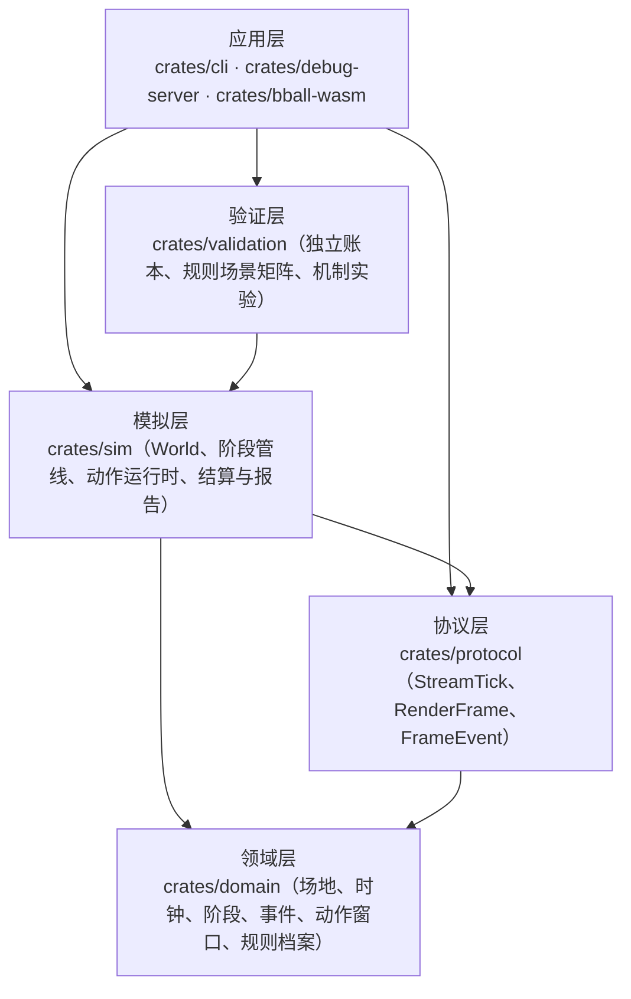
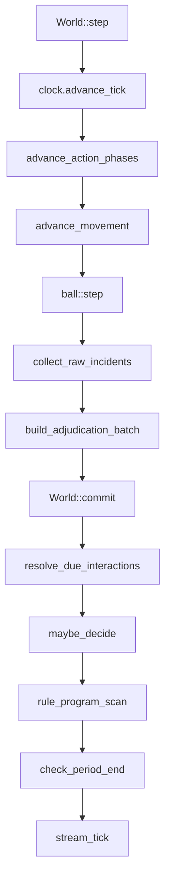
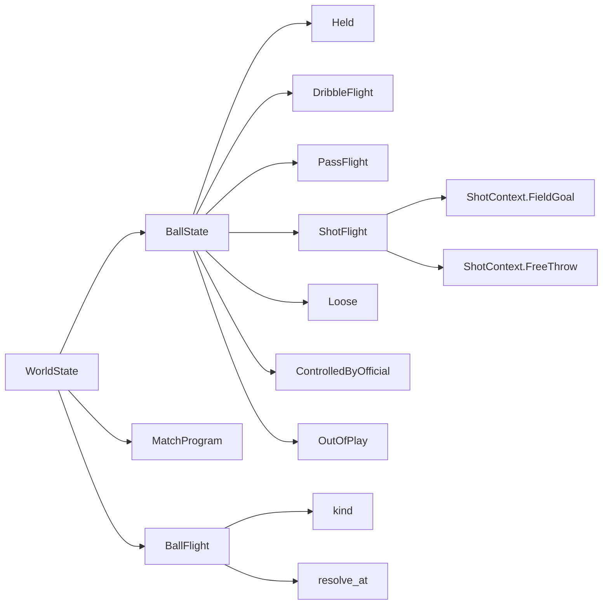
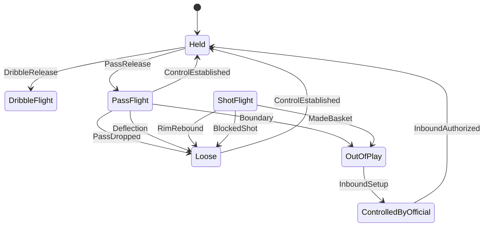

# NBA-Sim · 系统架构

> 定位：系统组织与模块交互的**架构规格**——分层、数据流、状态机、管线、决策、语义/裁决和多联赛。
> 上游文档：`docs/charter.md`；关联规格：`docs/basketball.md`、`docs/quality.md`、`docs/attributes.md`、`docs/tactics.md`、`docs/protocol.md`。
> 实现状态、迁移差距和验证范围统一见 `docs/dev/status.md` 与 `docs/dev/gap.md`；跨模块取舍见 `docs/decisions.md`。
> 修订纪律：本文档只定义目标架构和稳定边界，不记录当前实现快照、周期结果或执行命令。

---

## 0. 文档目的

本文档回答三个问题：

1. **系统如何组织** —— 分层架构与依赖规则（§1–§2）；
2. **状态如何流转** —— 球权状态机、主循环阶段管线、决策系统（§3–§5）；
3. **如何支撑多联赛** —— 规则档案与约束分轴（§6）。比赛动作和罚则程序见 `docs/basketball.md`，本文档只规定它们属于哪一层。

阅读顺序：§1（分层）→ §2（数据流）→ §3（球权状态机）→ §4（阶段管线）→ §5（决策）→ §6（语义/裁决/多联赛）。

---

## 1. 总体架构

### 1.1 设计原则

| 原则 | 一句话表述 |
| ------ | ----------- |
| **P1 单一事实源** | 球的归属只能从一个字段推导，其余全是派生只读视图 |
| **P2 不变量即代码** | 每 tick 在引擎内校验物理/篮球底线，违反立即暴露（详见 quality.md） |
| **P3 显式阶段管线** | 主循环是显式阶段序列的调度，顺序由调度器与窄签名保证而非注释 |
| **P4 意图-执行重校验** | 动作在执行点重新经过约束过滤，快照只用于生成候选 |
| **P5 确定性优先** | 相同种子必须产生完全相同的世界，否则一切检测都失去意义 |
| **P6 校准通道唯一** | 一切影响行为的数值必经 `GameRules`；公式进代码、系数进规则、调参走 JSON 覆盖 |
| **P7 能力涌现** | 一切场上行为是 `(球员能力, 规则, 比赛状态)` 的纯函数；禁止剧本化战术与经验常数（宪章 C1） |
| **P8 逐回合评判** | 真实度判断必须落到每一个回合、每一个阶段（宪章 C2，详见 quality.md） |

### 1.2 分层视图



**依赖规则（编译期强制）**：

- 上层可依赖下层，下层**禁止**反向依赖；
- `domain` 不依赖任何其他内部 crate；
- `protocol` 只依赖 `domain` 与 `serde`；
- `sim` 依赖 `domain` 与 `protocol`，承载比赛真相（`World`）；
- `validation` 依赖 `sim` 与 `domain`，只读公共事件做独立重建；
- `cli`、`debug-server`、`bball-wasm` 依赖 `sim` / `validation` / `protocol`，只读取快照与工件。

**`crates/sim/src` 的职责模块**（方案 §11）：内核按写入职责分目录，旧路径由 crate 根重导出保持可用。

| 目录 | 职责 | 具体模块 |
| --- | --- | --- |
| `clock/` | 独立计时器、运行条件与时间指令 | `ClockState`、`ClockDirective`、`ClockController`、`ClockCommitLog`、`ClockCheckpoint` |
| `program/` | 暂停、换人与轮换 | `timeouts`、`rotation` |
| `officiating/` | 违例、犯规、罚则与恢复计划 | `StoppageCause`、`PenaltyPlan`、`RestartPlan`、`ResumeContext`、`InboundLocation`、`ControlState`、`ControlHandover` |
| `actions/` | 动作生命周期、并行调度与技术细分 | `ActionKind`、`Fact`、`DefensiveActionKind` |
| `control/` | 球员控制、最后触球与回合边界 | `BallBody`、`BallState`、球权争抢 |
| `ledger/` | 比分、时间与统计投影 | `boxscore`、`report` |

`crates/domain/src/match_model.rs` 保存权威的比赛阶段、比赛程序、球态与迁移表；`crates/domain/src/identity.rs` 保存稳定身份类型与分配器；`crates/domain/src/flow.rs` 保存由权威阶段与程序派生的兼容投影 `GameFlowState`。

跳球、发球、罚球与节末程序的结算在 `world` 与 `resolve` 中，教练复核在 `challenge`。

### 1.3 红线宪章（`charter` §4 镜像，不可触碰）

以下条款源自 `docs/charter.md` §4，是本文档与一切实现的**不可修订红线**：违反任一条的改动 = 打回，无论动机多好。完整论证见 `charter`；本节只列工程执行细则与机械守卫——红线没有守卫只是愿望。

| 条款 | 内容 | 机械守卫 |
| ------ | ------ | --------- |
| **C1 无硬编码** | 一切影响行为的数字必经规则/数据通道；一切行为是 `(能力, 规则, 状态)` 的纯函数，禁止剧本化战术与"让画面像"的经验常数 | 内联常数 grep 守卫（protocol.md §2.1 M7 阈值）+ 能力扰动测试（quality.md §6） |
| **C2 评判实施** | 真实度判断逐回合、逐阶段产出裁决；禁止以"多场模拟原始结果统计"作为真实性评判；仅允许把"裁决结果"聚合为真实度指数 | 回合/阶段评判工件逐条写入（quality.md §2.1–2.3） |
| **C3 约束分轴** | 物理约束严格遵守且与联赛无关（可配置校准）；语义/规则约束按联赛档案 `LeagueProfile` 参数化（NBA/FIBA），灵活可配 | LeagueProfile 切换验收（§6.3、protocol.md §2.1 M10） |
| **C4 确定性** | 相同种子 → 逐 tick 完全相同的世界；一切评判、归因、校准对比的前提 | 黄金哈希（quality.md §5）入库且必须常绿 |

> 条款与原则的映射：P6 是 C1 的数值通道，P7 是 C1 的行为要求，P8 即 C2，C3 实施为 §6.3 的规则档案参数化，C4 是 P5 的宪章级强化。

---

## 2. 核心数据流（单 tick）



> **写入路径**：物理与程序发布 `RawIncident`，裁决层按 `(time_micros, sub_tick, event_id)` 排序后生成 `AdjudicationBatch`，`World::commit` 原子写入球态、控制、程序、时钟、罚则、动作运行时、账本与事件。动作生命周期使用同一 `action_id` 发布开始、阶段变化和唯一终态。协议、回放与验证只读事实流。

---

## 3. 球权状态机设计（P1 · 单一事实源）

### 3.1 设计：分离归属、程序与轨迹



`BallState` 保存球的宏观归属，七种状态覆盖持球、运球飞行、传球飞行、投篮飞行、松球、裁判控球与比赛用球离场。`ShotFlight` 携带 `ShotContext::{FieldGoal, FreeThrow}`，罚球飞行期间 `MatchProgram` 保持 `FreeThrows`。`BallFlight` 保存飞行种类与结算时刻，飞行不替换比赛程序。

`BallState::Held` 携带持球人身份。其他球态由 `ControlState` 给出控制球队、最后触球人与其球队、控制建立时刻、前场控制、触筐与触板身份。位置与速度由 `crates/sim/src/control/mod.rs` 的运动学参数按时间求值；`crates/sim/src/body.rs`、`motion.rs`、`physical.rs` 提供身体、手部、脚步、跳跃与接触证据。垂直分量由 `crates/domain/src/projectile.rs` 的 `ProjectileArc` 产生，弧顶由抛物线自然产生，出手与触筐时刻的初速由两端高度和飞行时长闭式反解，飞行时长受球速包络与动作窗口区间共同约束。

### 3.2 派生视图与写入边界

`holder`、`has_ball`、`team_control`、`frontcourt`、`in_flight`、`rim_contact` 与 `backboard_contact` 都由 `ControlState` 派生。公开投影只读，消费方不得持有第二份比赛真相。

控制序列按控制球队划分：同一队的传球只是控制人换手，序列不变；控制球队变了就是一次交接，交接是原子事件（上一段结束、新一段开始）。比赛结束时最后一段序列被明确关闭，因此「建立次数」与「结束次数」必然相等，独立验证器据此核对。

`World::step` 收集 `RawIncident`，按 `(time_micros, sub_tick, event_id)` 排序，交给 `AdjudicationBatch` 生成完整计划。`World::commit` 按固定顺序原子提交球态、控制、程序、时钟、罚则、动作运行时、账本与事件。所有物理到达、抢断、篮板、得分、出界与发球都经同一提交入口；字段私有化、调用图守卫和穷举测试阻止旁路写入。`ControlTransition` 的类型化前置条件在提交前检查，非法转换直接失败。

### 3.3 时钟的唯一写入口

`ClockState` 以整数微秒保存全部计时器与运行标志。`ClockDirective` 只有四种形态：`Start`、`Stop`、`Set` 与 `Restore`。`ClockController` 是唯一改钟入口：推进只读运行标志，标志本身只由 `Start` 与 `Stop` 写入，因此「哪些钟在走」永远有一条可重建的指令依据。

提交记录有三种形态：指令、连续推进段与检查点。连续推进合并成一段——段内没有任何指令写入，整段可以用「起点读数 + 推进时长」表达，因此逐 tick 推进不会让事件数膨胀。`Restore` 用于纠正：节末即时回放改判时，比赛钟从出手那一刻的检查点恢复。

独立验证器只读事件流：按提交顺序重放时钟得到终局读数，按交接事实重建控制序列。

### 3.3 球态与程序转换



`BallState` 转换只描述归属变化；程序变化由 `MatchProgram::{OpenPlay, JumpBall, Inbound, FreeThrows, Timeout, Review, PenaltyAdministration, PeriodSettlement, Intermission, Pregame, Complete}` 单独发布。节次切换时，已由在场球员持有的球保持原归属；停表球与松球经 `Inbound` 程序重建可取性。完整转换集合由 `nba_domain::match_model` 的迁移表给出，`BallBody::transition` 是唯一写入口，穷举测试拒绝每个非法边。

---

## 4. 主循环阶段化设计（P3 · 显式管线）

### 4.1 设计：固定因果管线

`World::step` 按固定次序推进：权威状态先产生原始事实，裁决层生成批次，`World::commit` 原子提交，投影层只读输出。


阶段函数只接收完成职责所需的窄参数，物理模块发布原始事实，动作模块发布动作状态，裁决模块生成计划，提交模块按完整计划更新比赛状态，协议层读取投影。`World::commit` 是唯一写入口。`RawIncident` 按 `(time_micros, sub_tick, event_id)` 排序；同刻事件的结果不依赖容器插入顺序。短路路径由 `PhaseOutcome` 表示，输出帧由调度器补齐，不变量校验在 `step()` 包装器中执行，任何路径都经过它。

### 4.2 收益

- **顺序错误变显式的调度器问题**：新增逻辑必须在调度序列中显式插入，无法"忘记"某步；
- **每阶段可单测**：构造所需字段，喂输入，断言 `PhaseOutcome`；
- **InvariantPhase 不可绕过**：它是调度序列固定最后一环，任何路径都经过它；
- **ShortCircuit 显式化**：取代分散的提前 `return` 出口。

### 4.3 权威状态分组

`WorldState` 按职责保存 `ClockState`、`ControlState`、`BallState`、`MatchProgram`、`ActionRuntime`、`InteractionRegistry`、`PenaltyQueue`、`PendingAdjudications`、`Ledger` 与 `EventJournal`。每个分组声明写入来源与读取视图。`ClockController` 是时钟写入口，`World::commit` 是跨分组写入口，`stream_tick` 只读投影。

空间量由 `crates/sim/src/state.rs` 与 `crates/domain/src/court.rs` 给出。防守势场求解器在求解时从在场进攻球员位置生成弱侧拓扑。分组定义与守卫共同阻止跨职责旁路写入。

---

## 5. 决策系统设计（P4 · 意图-执行重校验）

### 5.1 决策管线

```
感知 → 候选生成 → 硬约束过滤 → 物理可行性 → 软约束惩罚
     → 效用评分 → softmax 个性化采样
```

效用公式（复合律权威声明——`tactics.md` §5 的战术效用展开是 BaseValue 因子的内部构成，不另立顶层代数）：

```
FinalUtility = (BaseValue + SkillBonus + TendencyBonus + ContextBonus + PreferenceBonus)
               × Feasibility × StaminaModulation
               − SoftPenalty − RiskPenalty + MoraleBias(action family)
```

- 乘性部分是**物理与可行性门**：Feasibility 为 [0, 1] 连续系数（几何、防守封堵，不可行直接乘零）；StaminaModulation 为体力衰减因子；
- 加性部分是**偏好与惩罚修正**：战术基值、个体技能加成、倾向偏好、情境偏好在 BaseValue 侧求和；软约束、风险与士气作为独立项修正。
  士气项按**动作族**加权后相加（`ModulationRules.morale_*_affinity`）：采样是 softmax，
  全候选共享的加性常数在归一化中相互抵消，阶参数因此对选择分布零影响；
  按族加权使同一标量对不同候选产生不同修正，参数扰动可改变选择分布；
- `RoleFit` 因子已随聚类标签降级移除（`attributes.md` §2.7）：效用管线禁止读取位置、赛前攻防角色或派生标签。战术槽位适配只能作为 `TacticalFit` 输入，由 `(attributes, tendencies)` 经 `tactics.md` §2.3 适配分派生。

> **涌现要求（P7）**：上式所有因子必须可从 `(PlayerAttributes/PlayerTendencies, DecisionRules, 当前状态)` 派生；`TacticalFit` / 任何权重禁止是与能力无关的硬编码常数。能力耦合与扰动验证见 `quality.md` §6。

### 5.2 执行点重校验

**问题**：决策基于 T0 快照，动作在 T0+Δ 执行，期间世界已变。

**设计**：

1. 决策产出的是**意图（Intent）**而非**命令**，携带决策时刻的关键上下文摘要（接球人位置、防守距离、快照 tick）；
2. `ExecutionPhase` 在意图实施时，将**当前** `ConstraintContext` 重新过一遍该动作的硬约束子集；
3. 若重校验失败：
   - 传球：接球人已不在走廊 → 降级为 `Dwell`（持球观察），意图标记作废；"重新决策"指**下一决策 tick**（DecisionPhase，§2 [4]）重新生成候选，不在执行阶段就地决策——保持阶段分离；
   - 投篮：防守者已封盖到位 → 按 `contest_intensity` 重新计算，而非用决策时刻的值；
4. 重校验结果记入 `DecisionTrace`，供 quality.md §2.1 评判器分析"多少动作在实施时被迫改变"。

### 5.3 决策可解释性

`DecisionTrace` 必须包含候选效用、约束标记、概率分布。这是回合评判（quality.md §2.1）与校准闭环（protocol.md §1）的基础，**必须保证每个决策都有完整 trace**，禁止出现"决策了但没有 trace"的路径。

---

## 6. 语义与裁决层设计

### 6.1 分层职责

| 层 | 输入 | 输出 | 不含 |
| ---- | ------ | ------ | ------ |
| physics | 刚体/速度/碰撞 | `RawContact`, `PhysicsFact`, 弹道到达 | 任何篮球概念 |
| semantics | `RawContact` + 比赛上下文 | `ContactKind`(Screen/Block/Charge/...), `SpacingEvaluation`, `ShotEvaluation` | 犯规判定 |
| officiating | `SemanticContact` + 规则 | `Foul` / `NoCall` / `Violation` / 罚则 | 物理计算 |

**单向数据流**：physics → semantics → officiating，禁止反向。

**物理模块内部边界**：`crates/sim/src/body.rs` 定义身体与手部状态，`motion.rs` 负责积分、速度提案与碰撞求解，`physical.rs` 负责接触证据，`control/mod.rs` 负责球态与边界事实。物理层发布原始事实，语义层消费 `RawIncident`，裁决层消费类型化计划；单向数据流由调用图守卫核对。

### 6.2 裁决的确定性

- 犯规判定必须是**确定性函数** `f(contact_context, rules) -> Foul|NoCall`，随机性只体现在"是否吹罚可吹可不吹的边际接触"，且用种子 RNG；
- 所有裁决结果记入事件流，可回放重建。

### 6.3 规则档案与多联赛（宪章 C3）

**约束分轴**：两类约束的配置粒度不同，不可混用：

- **物理约束**（人体运动极限、球飞行与碰撞、最小间距）：严格遵守、全局可配置校准，但**与联赛无关**——FIBA 球员和 NBA 球员受同一套人体物理；
- **语义/规则约束**（计时结构、犯规政策、罚球与 bonus、违例尺度、几何）：必须按 `LeagueProfile` 参数化。语义层与裁决层是纯函数 `f(接触/空间事实, LeagueProfile)`——同一接触事实在不同档案下可以有不同判罚（边际吹罚尺度、bonus 触发、犯规上限）。

**LeagueProfile 差异表（首批两联赛；NCAA 为路线项）**：

| 档案字段 | NBA | FIBA |
| --- | --- | --- |
| 计时结构 | 4×12 min | 4×10 min |
| 进攻时钟 | 24 s，前场板重置 14 s | 24 s，前场板重置 14 s |
| 个人犯满 | 6 犯 | 5 犯 |
| 球队犯规罚则 | 每节第 5 次起；加时独立限额 | 每节第 5 次起；加时计入第 4 节 |
| 三分线 | ~23.75 ft（底角 22） | 6.75 m（等半径，无底角特例） |
| 交替拥有 | 跳球 | 交替拥有箭头 |

**验收原则**：切换联赛等于切换一份版本化规则档案，计时、几何、犯规政策、罚球、发球、跳球、换人、违例、复核与暂停程序随之生效；引擎代码路径不因联赛而分叉。`LeagueProfile` 按 `full_simulation_plan.md` §3.2 的 11 个策略族保存字段，加载时检查条件互斥、限额、程序完整性、几何、版本与引用；缺少必要字段直接返回配置错误，禁止静默补全。具体阶段顺序和证据要求见 `docs/protocol.md`。

---

## 7. 领域层设计（crates/domain）

### 7.1 职责边界

只承载**篮球本体词汇**，不包含任何"怎么打"的逻辑。

### 7.2 核心类型

| 类型 | 职责 | 关键约束 |
| ------ | ------ | --------- |
| `CourtGeometry` | 场地尺寸、篮筐位置、三分线、区域划分 | 构造时校验几何合法性（篮筐在界内等） |
| `GameRules` | 全部可调参数（时钟、物理上限、权重、阈值） | `validate()` 在 setup 时强制执行 |
| `DecisionRules` | 决策子系统参数（效用权重、约束阈值、采样个性化） | 独立 `validate()`，由 `decision` 消费；作为 `GameRules` 嵌套组注入 |
| `PlayerData` 系（`data.rs`） | `PlayerAttributes` 能力向量 + `PlayerTendencies` + 球队级 `TeamTraits` | 能力是行为差异的唯一合法来源（P7）；被 decision/physics/officiating 消费；**本体规格（分类学/值语义/锚点/迁移路线）以 `docs/attributes.md` 为单一事实源**；涌现要求见 quality.md §6 |
| `LeagueProfile` | 11 个版本化策略族：节次、时钟、进攻钟、犯规、罚球、发球、跳球、暂停、换人、违例、复核 | 程序见 `docs/basketball.md` §6；缺字段直接失败，不进入引擎联赛分支 |
| `GameFlowState` | 由 `MatchStage` 与 `MatchProgram` 派生的兼容投影 | 只读，转换由 `World::commit` 发布 |
| `SubPhase` | 程序内阶段：准备、授权、执行、完成 | 与 `MatchStage` 正交，由 `MatchProgram` 持有 |
| `BallState`（见 §3） | 七种球的宏观归属状态 | `ControlState` 与 `BallFlight` 共同给出完整球态 |
| `GameEvent` | 领域事实（得分/犯规/违例/接触/程序/时钟/控制/结算） | 值对象，不可变 |
| `ActionTimeWindow` | 一个动作从发起到结束的时间窗口 | 驱动运动学约束 |
| `FixedDt` | 固定步长与整数微秒时间单位 | 全引擎唯一时间推进单位 |

### 7.3 设计要点

- **规则参数集中（P6 的基石）**：所有影响行为的魔法数字（最大速度、最小间距、球速上限、效用权重、犯规阈值、节奏参数）必须收敛到 `GameRules`，禁止散落在子系统里写死。这是统计校准（protocol.md §1）的前提。
- **事件即事实**：`GameEvent` 是引擎对外的**事实**而非"日志"。回放、审计、统计全部从事件流重建，不依赖引擎内部字段。

---

## 8. 附录

### 8.1 与其他文档的关系

- `charter.md` 是**目标宪章**：要做出什么、什么算好、红线与成功判据。本文档是**系统组织规格**：模块如何分层、状态如何流转。映射：`charter` §4 宪章条款 → 本文档 §1.3；C1 → P6/P7；C3 → §6.3；C4 → P5；
- `basketball.md` 是**比赛过程规格**：动作生命周期、结果权、防守责任和罚则。本文档规定这些事实由哪个阶段产生，不复制其比赛语义；
- `quality.md` 是**检测与评判体系**：不变量、真实度评判、工具链、性能预算——本文档的架构如何被观测与验证；
- `attributes.md` / `tactics.md` 是**数据规格**：球员/阵容/战术的分类学与值语义——本文档的领域层消费它们；
- `protocol.md` 是**过程规格**：校准协议、验收标准和证据要求；
- `docs/dev/status.md` 是**当前实现状态**；`docs/dev/gap.md` 是**迁移差距与依赖**。它们不改变本文档的目标架构。

### 8.2 术语表

| 术语 | 定义 |
| ------ | ------ |
| **事实源 (SoT)** | 某一信息的唯一权威存储，其余为派生 |
| **意图 (Intent)** | 决策产出但尚未执行的动作，携带决策上下文 |
| **执行重校验** | 意图实施时基于当前世界重新过约束 |
| **ShortCircuit** | 阶段管线中本 tick 提前结束的显式信号 |
| **LeagueProfile** | 联赛规则档案（计时/犯规/几何/语义阈值），多联赛配置的载体（§6.3） |

### 8.3 关键 crate 依赖图

```
domain ◄── physics ◄── semantics ◄── officiating
  ▲         ▲            ▲
  │         │            │
  └─────────┴── decision ┘
                ▲
                │
              engine ──► protocol ◄── invariants
                ▲
        ┌───────┼────────┐
      cli  debug-server  bball-wasm
```

补边：`engine ──► invariants`——`step()` 包装器每 tick 调用 `check_tick`（quality.md §1.1）。
